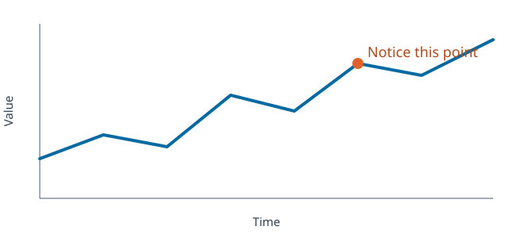

# A first chapter {#sec-first}

A chapter states one idea and shows it on an example. @fig-line shows a short series and @tbl-values lists its values.

{#fig-line}

| Step | Value |
|-----:|------:|
| 1 | 2 |
| 2 | 4 |
| 3 | 8 |

: Values of the series. {#tbl-values}

The series doubles at each step, which is the recurrence in @eq-double.

$$
x_{t+1} = 2 x_t
$$ {#eq-double}

::: {.callout-note}
## Remark
A callout carries a short remark that a reader may skip without losing the argument.
:::

## A section {#sec-section}

Sections are numbered from the chapter, so this is section 1.1; see also @sec-second.

Code is set in JetBrains Mono:

```python
series = [2, 4, 8]
```
