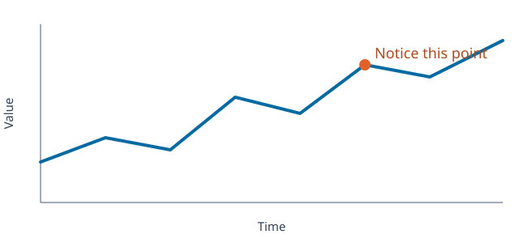

## {.title-slide-custom data-state="cover"}

Event or course · Place · Date

Sample Author talk

<b>Author name</b>

Supervisor or affiliation

<i class="bi bi-envelope"></i> name@example.org

::: notes
[0:30] Greet the audience, state the title and say in one sentence what the talk will show.
:::

## Outline {.acc-blue}

Outline

<h4><i class="bi bi-question-circle"></i>The question</h4>
Why it matters, in one sentence.

<h4><i class="bi bi-diagram-3"></i>The method</h4>
What was done, in one sentence.

<h4><i class="bi bi-check2-circle"></i>The answer</h4>
What was found and what it means.

One sentence that states the claim of the talk.

::: notes
[0:30] Walk through the three parts and name the claim.
:::

## A content slide: a figure, three findings and what they mean {.acc-blue}

<b>Part 1</b> · Result

::: {.split .f60 .mid}
:::: {}
{height="330"}

Caption: what the figure shows, the data and the unit.

::::
:::: {}

42% a headline number with its meaning

<b>A second finding</b> in one line

<b>A caveat</b> stated beside the result

::::
:::

What the result means for the audience, in one or two lines.

Source: data set and period.

::: notes
[1:30] Say what the figure shows, then the first finding, then the implication. Keep to the planned time.
:::

## A table slide {.acc-blue}

Part 1 · Comparison

<table class="grid">
<tr><th>Option</th><th>What it needs</th><th style="text-align:right">Result</th></tr>
<tr><td class="strong">Option A</td><td class="dim">A short description</td><td class="r">Best</td></tr>
<tr><td class="strong">Option B</td><td class="dim">A short description</td><td class="r">Second</td></tr>
</table>

12 ms

a key number and its label

3×

a second number

95%

a third number

::: notes
[1:00] Read the table by its conclusion, not row by row.
:::

## {background-color="#0C4A6E" .divider-slide}

2

Part 2 · Slides 5 to 7

The question of this part, in the words of the audience

Formal questionThe precise research or project question.

<i class="on"></i><i class="on"></i><i></i>

::: notes
[0:10] One sentence that introduces the part.
:::

## Conclusions {.acc-blue}

Conclusion

<h4><i class="bi bi-check2-circle"></i>Shown</h4><ul><li>What the work demonstrates</li></ul>

<h4><i class="bi bi-arrow-right-circle"></i>Enabled</h4><ul><li>What it makes possible</li></ul>

<h4><i class="bi bi-exclamation-circle"></i>Limits</h4><ul><li>What it does not show</li></ul>

::: notes
[1:00] Separate what was shown from what is only enabled, and state the limits first.
:::

## {background-color="var(--blue-deep)"}

Thank you

Questions are welcome

name@example.org

::: notes
[0:20] Closing sentence, then invite questions.
:::

<!-- ============================ BACKUP ============================ -->

## Backup: a detail for questions

Backup

- A fact or a table that is only needed if someone asks.
